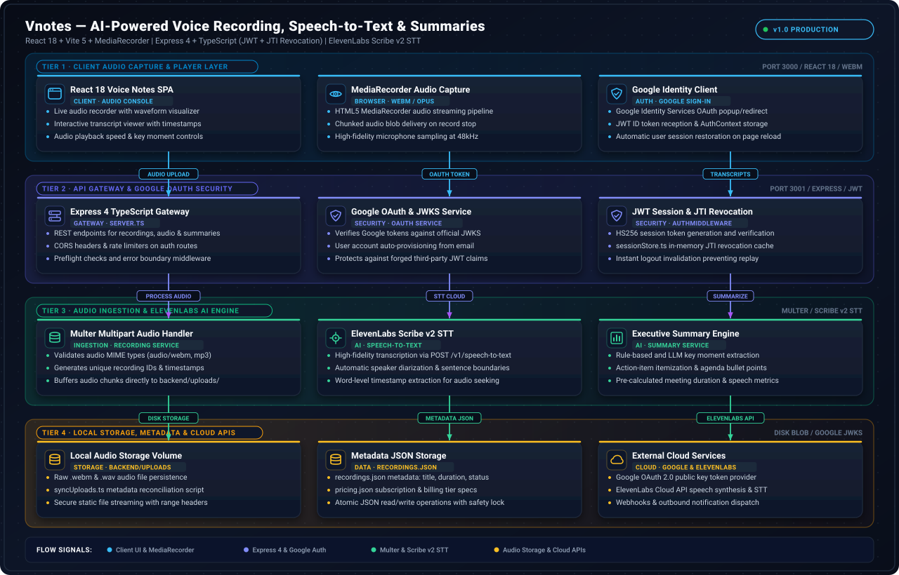

# VNotes System Architecture

This document provides a comprehensive architectural reference for **VNotes**, detailing its system design patterns, technology stack justifications, directory structure, component responsibilities, authentication lifecycles, and media processing pipelines.

---

## 1. Visual Architecture Overview



### Diagram Legend & Color Key

| Visual Element | Color / Style | Architectural Meaning |
| :--- | :--- | :--- |
| **Client Boundary** | Indigo Dashed (`#6366f1`) | Browser-side React 18 SPA, MediaRecorder capture, OAuth initiator, and local session state |
| **Server Boundary** | Violet Dashed (`#8b5cf6`) | Express 4 + TypeScript backend API, middleware pipeline, controllers, and domain services |
| **Middleware & Security** | Amber Cards (`#f59e0b`) | CORS guard, IP rate limiters (`oauthLimiter`, `logoutLimiter`), and HS256 JWT `authMiddleware` |
| **Storage Layer** | Emerald Cards (`#10b981`) | Local disk media store (`backend/uploads/`), JSON metadata store (`recordings.json`), and in-memory `sessionStore` |
| **External APIs** | Pink Cards (`#ec4899`) | Google OAuth 2.0 / JWKS endpoints and ElevenLabs Scribe v2 (`POST /v1/speech-to-text`) |
| **Primary Data Flow** | Solid Indigo Arrow | Authenticated REST API calls (`Authorization: Bearer <jwt>`) and multipart media uploads |
| **Auth / OAuth Flow** | Dashed Amber Arrow | OAuth 2.0 authorization code exchange, OIDC ID token verification, and JWT issuance/revocation |
| **Storage I/O Flow** | Solid Emerald Arrow | File stream reads/writes, `syncUploadsWithMetadata` startup reconciliation, and static `/uploads` serving |
| **External AI Flow** | Dashed Pink Arrow | Outbound multipart audio streaming to ElevenLabs API with graceful local fallback |

---

## 2. System Design Patterns

1. **Layered Controller-Service Architecture**:
   - **Routes (`backend/src/routes/`)** bind HTTP verbs, endpoint-specific rate limiters, `authMiddleware`, and `multer` file-upload handlers.
   - **Controllers (`backend/src/controllers/`)** handle HTTP request parsing, query/body validation, ownership verification (`recording.user_id !== req.userId`), and standardized JSON envelope responses (`{ success, data, error }`).
   - **Services (`backend/src/services/`)** encapsulate pure domain logic: OAuth code exchange and JWKS verification (`oauthService.ts`), JWT signing/validation (`authService.ts`), recording CRUD (`recordingService.ts`), ElevenLabs API integration (`transcriptionService.ts`), and heuristic NLP summarization (`summaryService.ts`).

2. **Stateless JWT Authentication with Stateful Revocation (`sessionStore.ts`)**:
   - VNotes combines fast stateless **HS256 JWT** verification (`iss: 'vnotes-backend'`, unique `jti`, `user_id`, `email`) with an in-memory revocation registry (`Map<string, RevokedSessionEntry>`).
   - When a user calls `POST /auth/logout`, both the raw token and its `jti` claim are recorded in `sessionStore`. Subsequent requests carrying that token are immediately rejected with `401 TOKEN_REVOKED`, and an hourly background timer purges expired entries to bound memory usage.

3. **Startup Storage Reconciliation (`syncUploads.ts`)**:
   - Before accepting traffic, `server.ts` executes `syncUploadsWithMetadata()`. This utility scans `backend/uploads/` on disk and cross-references every physical media file against `backend/src/data/recordings.json`.
   - Any orphaned media files found on disk without a metadata record are automatically indexed and registered in `recordings.json` with inferred media types (`audio` vs. `video`) and file sizes, preventing data loss across restarts.

4. **Graceful External AI Degradation**:
   - `transcriptionService.ts` streams uploaded media to ElevenLabs (`model_id: 'scribe_v2'`) with a 120-second timeout. If `ELEVENLABS_API_KEY` is unconfigured in local development, the service logs a warning and returns a deterministic placeholder transcript so developers can test the full recording -> transcription -> summary workflow offline.

5. **Fail-Fast Environment & Preflight Validation**:
   - `scripts/preflightCheck.js` validates `node_modules` and verifies that `VITE_GOOGLE_CLIENT_ID` in `frontend/.env` matches `GOOGLE_CLIENT_ID` in `backend/.env` before `npm run dev` starts.
   - `backend/src/config/env.ts` validates required secrets (`GOOGLE_CLIENT_ID`, `GOOGLE_CLIENT_SECRET`, `GOOGLE_REDIRECT_URI`, `JWT_SECRET >= 32 chars`, `JWT_EXPIRATION` bounds) at startup and halts with actionable remediation steps if misconfigured.

---

## 3. Technology Stack & Justifications

| Layer | Technology | Version | Justification |
| :--- | :--- | :--- | :--- |
| **Frontend UI** | React + TypeScript | `18.2.0` / `5.2.2` | Component-driven SPA with strict static typing for recording state, transcripts, and auth context |
| **Frontend Build** | Vite + Tailwind CSS | `5.0.8` / `3.3.6` | Sub-second HMR dev server on `:3000` and utility-first responsive styling |
| **Routing** | React Router DOM | `6.8.1` | Declarative client routing with `ProtectedRoute` session guards |
| **Backend Runtime** | Node.js + Express | `18+` / `4.18.2` | Mature, low-overhead HTTP server with composable middleware for Multer streams and rate limiting |
| **Authentication** | `google-auth-library` + `jsonwebtoken` | `9.3.0` / `9.0.2` | Official Google OIDC ID token cryptographic verification against Google JWKS + RFC 7519 HS256 JWTs |
| **Media Ingestion** | Multer | `1.4.5-lts.1` | High-performance `multipart/form-data` disk streaming supporting up to 500 MB audio/video files |
| **Rate Limiting** | `express-rate-limit` | `7.0.0` | Protects `/auth/oauth` (5 req / 5 min) and `/auth/logout` (10 req / 1 hr) from brute-force abuse |
| **Speech-to-Text** | ElevenLabs Scribe v2 | REST API (`v1`) | High-accuracy multilingual speech recognition via `axios` + `form-data` stream uploads |
| **Testing** | Vitest + `fast-check` + Supertest | `4.1.8` / `4.8.0` | Combines unit/integration tests with Property-Based Testing (`fast-check`) for cryptographic and auth invariants |

---

## 4. Repository Directory Layout

```text
Vnotes/
├── .github/                        # GitHub governance templates (PR, Issue templates, Code of Conduct)
├── docs/                           # Documentation suite and SVG architecture diagrams
│   ├── assets/
│   │   └── system-overview.svg     # Vector architecture diagram
│   ├── ARCHITECTURE.md             # Detailed architecture specification
│   ├── API.md                      # Complete REST API reference
│   └── DEVELOPMENT.md              # Developer setup & testing guide
├── scripts/
│   └── preflightCheck.js           # Pre-dev environment and Google Client ID parity validator
├── backend/                        # Express 4 + TypeScript API Server (:3001)
│   ├── src/
│   │   ├── config/
│   │   │   ├── env.ts              # Fail-fast environment variable loader & validator
│   │   │   ├── oauth.ts            # Google OAuth2Client initialization
│   │   │   └── supabase.ts         # Optional Supabase client configuration
│   │   ├── controllers/
│   │   │   ├── pricingController.ts    # Tier & feature comparison controller
│   │   │   └── recordingController.ts  # Upload, CRUD, key-moments, transcribe & summary handlers
│   │   ├── data/
│   │   │   ├── pricing.json        # Static pricing tiers and feature matrix
│   │   │   └── recordings.json     # Persistent JSON metadata store for recordings
│   │   ├── middlewares/
│   │   │   ├── authMiddleware.ts   # Bearer JWT extraction, revocation check, & signature verification
│   │   │   └── rateLimiter.ts      # IP rate limiters (oauthLimiter, logoutLimiter)
│   │   ├── routes/
│   │   │   ├── authRoutes.ts       # POST /auth/oauth, POST /auth/logout
│   │   │   ├── pricingRoutes.ts    # GET /api/pricing
│   │   │   ├── recordingRoutes.ts  # /api/recordings/* + Multer 500MB file filter
│   │   │   └── userRoutes.ts       # GET /api/user/profile
│   │   ├── services/
│   │   │   ├── authService.ts      # HS256 JWT generation & verification
│   │   │   ├── oauthService.ts     # Google code exchange & ID token JWKS verification
│   │   │   ├── recordingService.ts # Recording metadata CRUD, user filtering, & search
│   │   │   ├── summaryService.ts   # NLP sentence scoring, key points, & action item extraction
│   │   │   └── transcriptionService.ts # ElevenLabs Scribe v2 multipart streaming client
│   │   ├── utils/
│   │   │   ├── sessionStore.ts     # In-memory token & JTI revocation store with TTL cleanup
│   │   │   └── syncUploads.ts      # Startup disk-to-metadata reconciliation utility
│   │   └── server.ts               # Express app entry point, CORS, static /uploads, error handler
│   ├── tests/                      # Vitest unit, integration, and fast-check property-based tests (*.pbt.test.ts)
│   └── uploads/                    # Local disk storage for uploaded audio/video files
├── frontend/                       # React 18 + Vite 5 + Tailwind CSS SPA (:3000)
│   ├── src/
│   │   ├── components/             # Layout, Navbar, ProtectedRoute, RecordingPlayer, UploadModal, etc.
│   │   ├── context/                # AuthContext (session token, user profile, login/logout helpers)
│   │   ├── pages/                  # HomePage, LoginPage, OAuthCallbackPage, RecordingsPage, RecordingDetailPage, PricingPage
│   │   ├── services/               # Typed API client wrapper (api.ts)
│   │   ├── test/                   # Frontend Vitest + React Testing Library & PBT suites
│   │   ├── App.tsx                 # Route definitions & AuthProvider wrapper
│   │   └── main.tsx                # React DOM mounting entry point
│   └── vite.config.ts              # Vite dev server (:3000) and build configuration
├── docker-compose.yml              # Multi-container orchestration for backend (:3001) and frontend (:3000)
└── package.json                    # Root workspace scripts (predev, dev, build, start)
```

---

## 5. End-to-End Data Flows

### 5.1 Google OAuth 2.0 & Session JWT Lifecycle
1. **Initiation**: The user clicks "Sign in with Google" on `LoginPage.tsx`. The browser redirects to Google's OAuth 2.0 consent screen using `VITE_GOOGLE_CLIENT_ID` and `VITE_GOOGLE_REDIRECT_URI` (`http://localhost:3000/auth/callback`).
2. **Callback Capture**: Google redirects back to `OAuthCallbackPage.tsx` with `?code=<auth_code>`. The frontend posts `{ code }` to `POST /auth/oauth`.
3. **Code Exchange & OIDC Verification**:
   - `oauthLimiter` ensures the client IP has not exceeded 5 attempts within 5 minutes.
   - `oauthService.exchangeAuthorizationCode(code)` calls Google's token endpoint via `OAuth2Client.getToken(code)` to retrieve `id_token`.
   - `oauthService.verifyAndDecodeIdToken(idToken)` cryptographically verifies the `id_token` signature against Google's JWKS keys, checks `aud === GOOGLE_CLIENT_ID`, `iss` (`accounts.google.com`), and `exp`, and extracts `{ user_id: payload.sub, email, name, profile_picture_url }`.
4. **JWT Issuance**: `authService.generateJWT()` signs an HS256 token containing `{ user_id, email, iat, exp, iss: 'vnotes-backend', jti: crypto.randomUUID() }` and returns `{ success: true, sessionToken, user, expiresIn }` to the SPA.
5. **Authenticated Requests & Logout**: The SPA includes `Authorization: Bearer <sessionToken>` on `/api/*` requests. When logging out via `POST /auth/logout`, `authMiddleware` validates the token and `sessionStore.revokeSession()` blacklists both the token string and its `jti`.

### 5.2 Media Upload, Transcription & Summarization Pipeline
1. **Upload (`POST /api/recordings/upload`)**:
   - `authMiddleware` authenticates the user and attaches `req.userId`.
   - Multer validates the MIME type against allowed audio (`wav`, `mpeg`, `mp3`, `m4a`, `aac`, `flac`) and video (`mp4`, `x-matroska`, `mkv`, `webm`, `avi`, `quicktime`) formats, enforces a 500 MB cap, and writes the file to `backend/uploads/<timestamp>-<random>.<ext>`.
   - `recordingService.saveRecordingMetadata()` persists a new `Recording` entry tied to `user_id: req.userId` in `backend/src/data/recordings.json`.
2. **Transcription (`POST /api/recordings/:id/transcribe`)**:
   - `recordingController` verifies the recording exists and belongs to `req.userId` (`403 FORBIDDEN` otherwise).
   - `transcriptionService.transcribeAudio(filePath)` streams the file from `backend/uploads/` via `FormData` to `https://api.elevenlabs.io/v1/speech-to-text` with `model_id: 'scribe_v2'`.
   - The returned transcript text is saved to `recording.transcription` in `recordings.json`.
3. **Executive Summary (`POST /api/recordings/:id/summary`)**:
   - Requires `recording.transcription` to be populated (`400 NO_TRANSCRIPTION` if missing).
   - `summaryService.generateSummary(transcription)` segments sentences, ranks key points using cue-word heuristics (`important`, `decided`, `conclusion`, `key`, etc.), extracts action items (`need to`, `should`, `will`, `must`, `todo`, `action`), and updates `summary`, `keyPoints`, and `actionItems` on the recording record.
