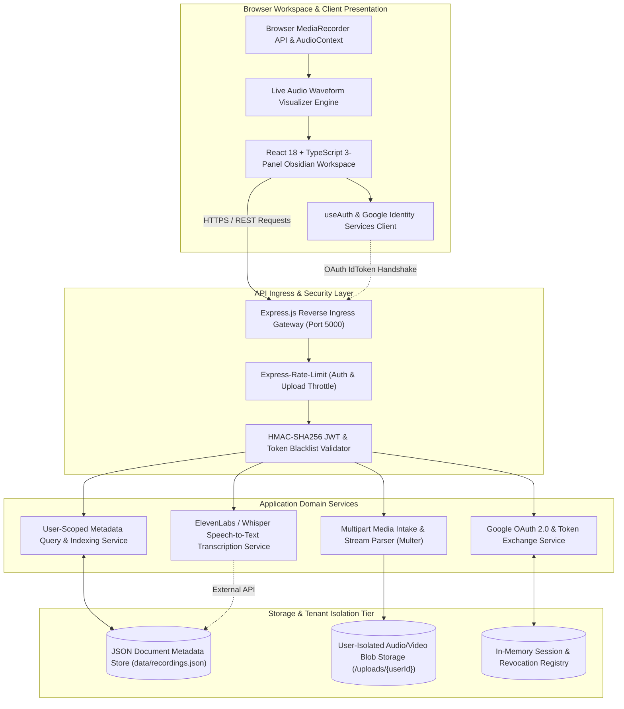

# VNotes: Enterprise Voice & Multimedia Knowledge Platform

[](https://react.dev/)
[](https://expressjs.com/)
[](https://developers.google.com/identity/protocols/oauth2)
[](https://elevenlabs.io/)
[](https://vitest.dev/)
[](LICENSE)

> **Enterprise multimedia voice recording and intelligence platform delivering high-fidelity audio capture, automated speech transcription pipelines, user-isolated storage partitions, and federated Google OAuth 2.0 identity.**

---

## Architecture & Data Flow Diagram



---

## Core Features

- **High-Fidelity Audio & Video Intake**: Browser-native capture utilizing the Web Audio API with real-time dynamic frequency waveform canvas visualization supporting multi-format inputs (WAV, MP3, M4A, FLAC, MP4, WebM).
- **Federated Google OAuth 2.0 & JWT Security**: Enterprise authentication gateway managing token exchanges, secure cookie/bearer hydration, session blacklisting, and per-user recording partitions.
- **Strict Multi-Tenant Isolation**: Structural user-scoped filesystem boundaries ensuring recordings and metadata indexes are strictly locked to the originating user claims.
- **Asynchronous AI Transcription Engine**: Modular speech-to-text pipeline integrating ElevenLabs and Whisper APIs to produce timestamped transcripts and automated summary notes.
- **Obsidian Design System**: High-performance dark-mode interface featuring glassmorphic accents, customizable playback speeds (0.5x to 2.0x), keyboard shortcuts, and dynamic modal overlays.
- **Robust Verification Suite**: Full test coverage utilizing Vitest and Fast-Check property testing for upload boundary constraints, token life-cycles, and metadata serialization.

---

## Tech Stack Directory

| Layer | Technologies |
| :--- | :--- |
| **Frontend Platform** | React 18, TypeScript 5.3, Vite 5, TailwindCSS, Lucide React |
| **Backend & Ingress** | Express 4.18, TypeScript, Node.js (v18+), Multer, Express-Rate-Limit |
| **Identity & Security**| Google Auth Library 9.3, JSONWebToken (JWT) 9.0, Bcrypt |
| **Media & Audio** | Browser MediaStream & AudioContext API, Axios, ElevenLabs Speech SDK |
| **DevOps & Verification** | Vitest, Fast-Check (Property-Based Testing), Supertest, Concurrently |

---

## Quickstart & Verification

### Prerequisites
- **Node.js**: `v18.0.0` or higher
- **Package Manager**: `npm` or `yarn`
- **Google Cloud Console**: OAuth 2.0 Client Credentials

### Environment Configuration
Copy `.env.example` to `.env` in the project root:

```env
# Server Runtime
PORT=5000
NODE_ENV=development
FRONTEND_URL=http://localhost:5173

# Security & Tokens
JWT_SECRET=enterprise_vnotes_production_jwt_signing_key
SESSION_SECRET=enterprise_vnotes_session_secret_key

# Google OAuth Credentials
GOOGLE_CLIENT_ID=your_google_client_id_here.apps.googleusercontent.com
GOOGLE_CLIENT_SECRET=your_google_client_secret_here

# Speech-to-Text Services (Optional)
ELEVENLABS_API_KEY=your_elevenlabs_api_key_here
```

### Installation & Execution
```bash
# 1. Install root, backend, and frontend dependencies
npm install
npm --prefix backend install
npm --prefix frontend install

# 2. Execute unit, integration, and property tests
npm --prefix backend test

# 3. Launch full-stack development environment (Backend + Frontend)
npm run dev
```

---

## API & Route Specification

| HTTP Method | Route | Authorization | Parameters / Payload | Expected Response | Description |
| :--- | :--- | :--- | :--- | :--- | :--- |
| `POST` | `/api/auth/google` | Public | `{ idToken: string }` | `200 OK` + `{ token, user }` | Authenticate Google OAuth credential and issue JWT |
| `POST` | `/api/auth/logout` | Bearer Token | None | `200 OK` + `{ success: true }` | Revoke session and blacklist current bearer token |
| `GET` | `/api/auth/me` | Bearer Token | None | `200 OK` + User Profile | Retrieve authenticated user claims |
| `POST` | `/api/recordings` | Bearer Token | Multipart Form: `file` (Media) | `201 Created` + `Recording` | Ingest and persist user voice/video recording |
| `GET` | `/api/recordings` | Bearer Token | Query: `search`, `limit`, `page`| `200 OK` + `Recording[]` | Fetch user-scoped library catalog |
| `GET` | `/api/recordings/:id`| Bearer Token| Route: `id` | `200 OK` + `Recording` | Retrieve metadata for specific recording |
| `DELETE`| `/api/recordings/:id`| Bearer Token| Route: `id` | `200 OK` + `{ success: true }` | Safely delete recording file and metadata record |
| `POST` | `/api/recordings/:id/transcribe`| Bearer Token| Route: `id` | `202 Accepted` + `JobStatus` | Trigger async speech-to-text transcription worker |
