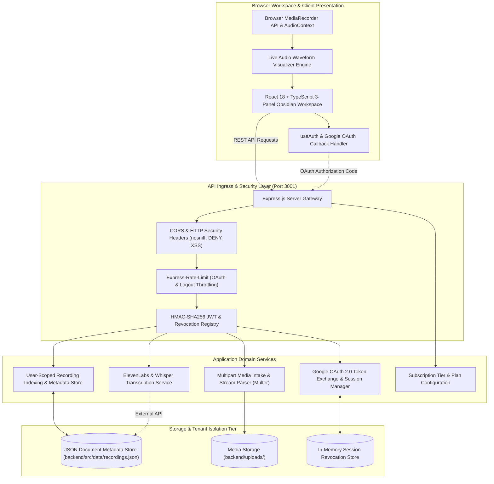

# VNotes: Enterprise Voice & Multimedia Knowledge Platform

[](https://react.dev/)
[](https://expressjs.com/)
[](https://developers.google.com/identity/protocols/oauth2)
[](https://elevenlabs.io/)
[](https://vitest.dev/)
[](LICENSE)

> **Enterprise multimedia voice recording and intelligence platform delivering high-fidelity audio capture, automated speech transcription pipelines, user-isolated storage partitions, and federated Google OAuth 2.0 identity.**

---

## Architecture & Data Flow Diagram



---

## Core Features

- **High-Fidelity Audio & Video Intake**: Browser-native capture utilizing the Web Audio API with real-time dynamic frequency waveform canvas visualization supporting multi-format inputs (`.wav`, `.mp3`, `.m4a`, `.flac`, `.mp4`, `.webm`, up to 500MB).
- **Federated Google OAuth 2.0 & JWT Security**: Complete OAuth 2.0 authorization code exchange pipeline with cryptographic signature validation, per-user JWT sessions with `jti` replay prevention, and in-memory session revocation.
- **Strict Multi-Tenant Isolation**: Structural user-scoped filesystem boundaries ensuring recordings and metadata indexes are strictly locked to the originating user claims.
- **Asynchronous AI Transcription Engine**: Modular speech-to-text pipeline integrating ElevenLabs and Whisper APIs to produce timestamped transcripts and automated summary notes.
- **Obsidian 3-Panel Design System**: High-performance dark-mode interface featuring glassmorphic accents, customizable playback speeds (0.5x to 2.0x), waveform seeking, and dynamic modal overlays.
- **Comprehensive Verification Suite**: Complete test coverage across frontend components (Vitest, React Testing Library) and backend services (Vitest, Supertest, Fast-Check Property-Based Testing).

---

## Tech Stack Directory

| Layer | Technologies |
| :--- | :--- |
| **Frontend Platform** | React 18, TypeScript 5.2, Vite 5, TailwindCSS 3.3, Lucide React, Vitest |
| **Backend & Ingress** | Express 4.18, TypeScript 5.3, Node.js (v18+), Multer, Express-Rate-Limit |
| **Identity & Security**| Google Auth Library 9.3, JSONWebToken (JWT) 9.0, Node.js Crypto |
| **Media & Audio** | Browser MediaStream & AudioContext API, Axios, ElevenLabs Speech API |
| **DevOps & Verification** | Vitest, Fast-Check (Property-Based Testing), Supertest, Concurrently |

---

## Quickstart & Verification

### Prerequisites
- **Node.js**: `v18.0.0` or higher
- **Package Manager**: `npm`
- **Google Cloud Console**: OAuth 2.0 Client Credentials (for Google Authentication)

### Environment Configuration
Copy `.env.example` to `.env` in the project root:

```env
# Server Configuration
PORT=3001
NODE_ENV=development

# CORS Configuration
CORS_ORIGIN=http://localhost:3000

# File Upload Configuration
UPLOADS_DIR=uploads
MAX_FILE_SIZE=524288000

# Google OAuth Credentials
GOOGLE_OAUTH_CLIENT_ID=your-google-oauth-client-id-here.apps.googleusercontent.com
GOOGLE_OAUTH_CLIENT_SECRET=your-google-oauth-client-secret-here
GOOGLE_OAUTH_CALLBACK_URI=http://localhost:3001/auth/oauth/callback

# JWT Configuration (min 32 characters for HMAC-SHA256)
JWT_SECRET=your-256-bit-jwt-secret-here-minimum-32-chars
JWT_EXPIRATION=86400

# Supabase Configuration (Optional for cloud DB sync)
SUPABASE_URL=https://your-project.supabase.co
SUPABASE_ANON_KEY=your-anon-key-here
SUPABASE_SERVICE_ROLE_KEY=your-service-role-key-here

# ElevenLabs Speech-to-Text (Optional)
ELEVENLABS_API_KEY=your_elevenlabs_api_key_here
```

### Installation & Execution
```bash
# 1. Install root, backend, and frontend dependencies
npm install
npm --prefix backend install
npm --prefix frontend install

# 2. Run system preflight validation
npm run predev

# 3. Launch full-stack development environment (Backend + Frontend)
npm run dev

# 4. Production build
npm run build
```

### Running Test Suites
```bash
# Frontend component and integration tests (17 test files, 111 tests)
npm --prefix frontend test

# Backend unit and in-memory integration test suites (197 tests)
npm --prefix backend test

# Backend live HTTP API endpoint tests (requires backend running on port 3001)
npm --prefix backend run test:api

# Backend JWT property-based verification
npm --prefix backend run test:auth
```

---

## API & Route Specification

### Authentication Endpoints

| HTTP Method | Route | Authorization | Parameters / Payload | Expected Response | Description |
| :--- | :--- | :--- | :--- | :--- | :--- |
| `POST` | `/auth/oauth` | Public (Rate-limited: 5/5min) | `{ code: string }` | `200 OK` + `{ success: true, sessionToken, user, expiresIn }` | Exchange Google OAuth code for JWT session |
| `POST` | `/auth/logout` | Bearer Token (Rate-limited: 10/hr) | None | `200 OK` + `{ success: true, message: 'Logged out successfully' }` | Revoke session and blacklist session token |
| `GET` | `/api/user/profile`| Bearer Token | None | `200 OK` + `{ success: true, user }` | Retrieve current authenticated user profile |

### Recording Management Endpoints

| HTTP Method | Route | Authorization | Parameters / Payload | Expected Response | Description |
| :--- | :--- | :--- | :--- | :--- | :--- |
| `GET` | `/api/recordings` | Bearer Token | Query: `?q=searchterm` (optional) | `200 OK` + `{ success: true, data: Recording[] }` | Fetch user-scoped library catalog |
| `POST` | `/api/recordings/upload`| Bearer Token | Multipart Form: `file` (Media) | `201 Created` + `{ success: true, data: Recording }` | Upload and persist user recording file |
| `GET` | `/api/recordings/:id`| Bearer Token | Route: `id` | `200 OK` + `{ success: true, data: Recording }` | Retrieve metadata for specific recording |
| `DELETE`| `/api/recordings/:id`| Bearer Token | Route: `id` | `200 OK` + `{ success: true, message: string }` | Delete recording file and metadata record |

### AI & Media Enhancement Endpoints

| HTTP Method | Route | Authorization | Parameters / Payload | Expected Response | Description |
| :--- | :--- | :--- | :--- | :--- | :--- |
| `POST` | `/api/recordings/:id/summary` | Bearer Token | Route: `id` | `200 OK` + `{ success: true, summary, keyPoints, actionItems }` | Generate AI summary and action items |
| `POST` | `/api/recordings/:id/transcribe` | Bearer Token | Route: `id` | `200 OK` + `{ success: true, transcription }` | Run speech-to-text transcription pipeline |
| `POST` | `/api/recordings/:id/key-moments`| Bearer Token | `{ time: string, label: string }` | `200 OK` + Updated Recording | Add timestamped key moment |
| `DELETE`| `/api/recordings/:id/key-moments`| Bearer Token | `{ time: string }` | `200 OK` + Updated Recording | Remove key moment |

### Pricing & System Endpoints

| HTTP Method | Route | Authorization | Parameters / Payload | Expected Response | Description |
| :--- | :--- | :--- | :--- | :--- | :--- |
| `GET` | `/api/pricing/plans` | Public | None | `200 OK` + Subscription Tier Plans | Retrieve available pricing models |
| `GET` | `/health` | Public | None | `200 OK` + `{ status: 'ok', timestamp }` | Service health status check |
| `GET` | `/` | Public | None | `200 OK` + API status & version | API root gateway status |
| `GET` | `/uploads/:filename` | Public | Route: `filename` | Raw Media Stream | Serve uploaded audio/video files |
